<!-- Language Switcher Bar -->
<p align="right">
  <a href="https://github.com/05rdev/05rDev/blob/main/README_VI.md">
    
  </a>
  <a href="https://github.com/05rdev/05rDev/blob/main/README.md">
    
  </a>
</p>

<div align="center">

  <!-- Animated Quantum Aurora Banner -->
  <a href="https://github.com/05rdev">
    
  </a>

  <br/><br/>

  <!-- Dynamic Typing Effect (English) -->
  <a href="https://github.com/05rdev">
    
  </a>

  <p align="center">
    <a href="mailto:vandinh.aidev@gmail.com"></a>
    <a href="https://t.me/is05rDev"></a>
    <a href="https://discord.gg/pTbmY3Dx"></a>
    
  </p>

</div>

---

### 👤 About Me

```yaml
profile:
  full_name: "Huynh Van Dinh (05rDev)"
  education: "Associate Degree in Information Technology"
  target_role: "Fresher / Junior Software Developer"
  foundation: "Core IT fundamentals; adaptable across stacks rather than specialized in one language"
  key_strength: "Effective AI-assisted workflow — research, prototyping, debugging & delivery"
  availability: "Open to full-time opportunities"
```

- 🎓 **Background & Goal:** IT College graduate with foundational knowledge of programming, databases, and software development; seeking a **Fresher / Junior Developer** position to grow through real-world production projects.
- 🤖 **AI-Assisted Productivity:** My main strength is using modern AI tools systematically and effectively — breaking down requirements, providing clear context, researching unfamiliar tools quickly, drafting boilerplate, debugging issues, and assembling working features.
- 🧩 **Stack Flexibility:** Because I rely heavily on AI rather than specializing deeply in a single language, I am comfortable picking up and adapting to whatever tech stack a team already uses.
- 🤝 **Work Ethic:** Honest about my current technical depth, careful to review and test AI-generated code rather than trusting it blindly, and eager to learn engineering standards from mentors and teammates.
- 📫 **Contact:** Feel free to reach out via Email or Telegram above if your team is looking for a transparent, fast-learning junior contributor.

---

### 🛠️ Languages, Frameworks & Tools Worked With

> *Technologies and tools I have used in coursework and personal projects (mostly with AI assistance), listed as prior exposure rather than deep mastery.*

| Category | Technologies & Tools |
| :--- | :--- |
| **🤖 AI Workflow** |        |
| **💻 Languages** |       |
| **🌐 Web & Mobile** |       |
| **🗄️ DB & Tools** |       |

---

### 📊 GitHub Activity & Workflow

<div align="center">

  <a href="https://github.com/05rdev">
    
  </a>

</div>

---

### ⚡ 365-Day Contribution Matrix

<div align="center">
  
  <p><i>365-day contribution frequency and activity waveform (updated automatically via GitHub Actions).</i></p>
</div>

---

<div align="center">
  <sub><a href="https://github.com/05rdev"><b>05rDev</b></a> • Focused on continuous learning and practical building.</sub>
</div>
