<!-- Language Switcher Bar -->
<p align="right">
  <a href="https://github.com/05rdev/05rDev/blob/main/README_VI.md">
    
  </a>
  <a href="https://github.com/05rdev/05rDev/blob/main/README.md">
    
  </a>
</p>

<div align="center">

  <!-- Animated Quantum Aurora Banner -->
  <a href="https://github.com/05rdev">
    
  </a>

  <br/><br/>

  <!-- Dynamic Typing Effect (Vietnamese) -->
  <a href="https://github.com/05rdev">
    
  </a>

  <p align="center">
    <a href="mailto:vandinh.aidev@gmail.com"></a>
    <a href="https://t.me/is05rDev"></a>
    <a href="https://discord.gg/pTbmY3Dx"></a>
    
  </p>

</div>

---

### 👤 Về bản thân tôi

```yaml
ho_so:
  ho_va_ten: "Huỳnh Văn Định (05rDev)"
  hoc_van: "Tốt nghiệp Cao đẳng Công nghệ Thông tin"
  muc_tieu: "Fresher / Junior Software Developer"
  nen_tang: "Kiến thức CNTT cơ bản, linh hoạt đa công nghệ (không cố định 1 ngôn ngữ)"
  the_manh: "Ứng dụng AI hiệu quả để tìm hiểu, triển khai, debug & hoàn thiện sản phẩm"
  trang_thai: "Sẵn sàng làm việc toàn thời gian & học hỏi quy trình thực tế"
```

- 🎓 **Học vấn & Định hướng:** Tốt nghiệp Cao đẳng ngành **Công nghệ Thông tin** với nền tảng lập trình và cơ sở dữ liệu ở mức cơ bản; đang tìm kiếm cơ hội ở vị trí **Fresher / Junior Developer** để rèn luyện chuyên môn qua các dự án thực tế.
- 🤖 **Thế mạnh ứng dụng AI:** Điểm mạnh lớn nhất của mình là khai thác các công cụ AI một cách bài bản — biết cách chia nhỏ bài toán, mô tả ngữ cảnh rõ ràng, dùng AI để tra cứu tài liệu, dựng khung tính năng, đọc hiểu code, tìm nguyên nhân lỗi và ghép nối thành sản phẩm hoàn chỉnh.
- 🧩 **Linh hoạt về công nghệ:** Vì phần lớn công việc được triển khai cùng sự hỗ trợ của AI thay vì chuyên sâu cố định một ngôn ngữ, mình có thể làm quen nhanh với tech stack sẵn có của đội ngũ khi cần.
- 🤝 **Thái độ làm việc:** Thẳng thắn nhìn nhận giới hạn kiến thức nền tảng hiện tại, luôn chủ động kiểm tra lại kết quả do AI gợi ý, chú trọng khả năng chạy ổn định và sẵn sàng tiếp thu góp ý từ mentor/senior.
- 📫 **Liên hệ tuyển dụng:** Mời anh/chị kết nối qua Email hoặc Telegram bên trên nếu đội ngũ đang cần một ứng viên cầu tiến, trung thực và biết tận dụng AI để tăng tốc độ tiếp cận công việc.

---

### 🛠️ Ngôn ngữ, Framework & Công cụ đã từng dùng

> *Đây là các ngôn ngữ, framework và công cụ mình từng tiếp xúc trong quá trình học tập và làm dự án cá nhân (đa số có sự hỗ trợ của AI), không phải danh sách kỹ năng thành thạo chuyên sâu.*

| Nhóm | Công nghệ & Công cụ |
| :--- | :--- |
| **🤖 Công cụ AI** |        |
| **💻 Ngôn ngữ** |       |
| **🌐 Web & Mobile** |       |
| **🗄️ CSDL & Công cụ** |       |

---

### 📊 Hoạt động GitHub & Quy trình Làm việc

<div align="center">

  <a href="https://github.com/05rdev">
    
  </a>

</div>

---

### ⚡ Biểu đồ Đóng góp 365 ngày

<div align="center">
  
  <p><i>Biểu đồ tần suất đóng góp mã nguồn trong 365 ngày gần nhất (tự động cập nhật qua GitHub Actions).</i></p>
</div>

---

<div align="center">
  <sub><a href="https://github.com/05rdev"><b>05rDev</b></a> • Không ngừng học hỏi, làm việc nghiêm túc và cải thiện mỗi ngày.</sub>
</div>
